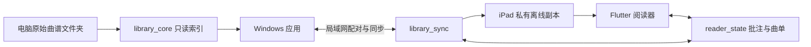

# 架构说明

[返回首页](../README.md) · [构建文档](BUILDING.md)

## 组件关系

| 位置 | 责任 |
| --- | --- |
| `lib/library/` | 多来源谱库、导航历史、搜索、页数与图标 |
| `lib/reader/` | 会话、布局、输入、解码、批注与曲单 |
| `lib/sync/` | 二维码配对、连接、下载选择和离线界面 |
| `lib/signing/` | 签名有效期提示 |
| `packages/library_core/` | 只读索引、稳定条目身份、内容版本与扫描恢复 |
| `packages/reader_state/` | 阅读位置、笔迹、文字、曲单、持久化与合并 |
| `packages/library_sync/` | 认证传输、清单、离线对象、同步事务和设备报告 |
| `windows/runner/` | 原生窗口、进程入口、资源与任务栏身份 |
| `tools/windows/` | 固定启动器、部署指针与开始菜单快捷方式 |
| `ios/Runner/` | 原生桥接、相机、图像处理和签名日期解析 |

## 原谱、条目与版本

源路径是本机定位方式，不是跨设备稳定身份。条目 ID 区分谱库曲谱，内容相同但路径不同的文件也可能是独立条目；内容版本区分同一条目的不同字节。

批注按条目、版本和页码关联，避免外部替换后套用旧坐标。重命名和移动的识别依赖可用证据，重复内容存在歧义时不只凭哈希静默合并。

普通扫描复用未变化文件的哈希，完整校验重新读取内容。文件监听只用于触发重扫，不能代替完整目录遍历。所有状态文件位于源谱库之外。

## 阅读与批注

界面读取文件、准备页数与布局，`reader_state` 管理持久数据。页面与批注共用变换，笔迹点位使用页面坐标而非屏幕绝对像素。

笔迹、文字和删除记录保存在应用状态中，不重写 PDF 或图片。修改模型时检查代码中的 schema 与兼容分支，不能照早期说明假定旧格式。撤销重做是会话历史，导入其他设备编辑后可能失效；持久保存成功前不能承诺已保存。

## 目录同步与内容下载

目录可以展示尚未下载的条目。下载选择决定哪些文件准备到 iPad，不以清单中存在就判定离线可读。

私有存储路径由受控身份生成，不直接使用对端逻辑路径写盘。传输核对长度和 SHA-256，临时写入后提交；失败保留最后成功清单和可复用的完整文件。普通暖启动可复用核验记录，完整校验重新读文件，这是性能取舍而非本地恶意篡改防护。

批注和曲单使用带共同基线的合并，冲突保留完整版本；持久事务记录支持重试。时间戳不作为简单覆盖另一端的唯一依据。当前 UI 展示冲突，尚无完整选版解决流程。

## 持久化与平台入口

索引、阅读状态、同步设置、配对状态和离线副本保存在应用支持目录。核心持久化使用临时提交、备份和锁或租约。备份恢复可能缺少最近修改，必须展示警告；多个进程不可共享同一状态目录。

Windows 固定启动器读取 `deployment.json`，定位完整版本目录，使用统一 AppUserModelID 保持开始菜单及任务栏身份。发布脚本校验目录后切换指针，不修改阅读数据或终止应用。见 [Windows 工具说明](../tools/windows/README.md)。

iOS 原生层负责扫码、图像解码和签名日期等能力。签名日期解析只提取显示信息，不校验真实性、撤销状态或自动续签。电脑保存设备报告和接收时间，历史报告不表示实时在线。

## 网络与修改检查

二维码携带应用的局域网地址、临时码和有效期；扫码不打开任意网页。后续请求使用随机 Bearer 凭据，不放入 URL。HTTP 认证不提供传输加密，不将监听端口映射到公网。详见 [安全说明](../SECURITY.md)。

变更重点：谱库身份及歧义；页面与批注坐标、异步旧帧和跨曲边界；同步提交原子性、重试及冲突保留；原生平台与实际硬件行为。自动化、合成素材和电脑预览只能证明其覆盖条件，不能代替真机验收。
